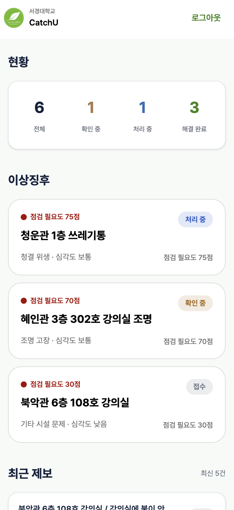

# 🏫 Catch-U

> 불편이 문제가 되기 전에, 캠퍼스의 이상 신호를 먼저 발견한다.

**Catch-U**는 학생들의 캠퍼스 불편 제보를 AI가 분석하여 반복되는 문제의 이상징후를 발견하고, 관리자가 신속하게 대응할 수 있도록 돕는 서비스입니다.

## 🔗 배포 링크

🌐 **Web Service** → https://catch-u.netlify.app

## ✨ 주요 기능

### 👩‍🎓 학생 기능

| 기능 | 설명 |
| --- | --- |
| 🔐 로그인 및 회원가입 | 사용자 인증 및 입력값 검증 |
| 🏠 학생 홈 | 진행 중인 내 제보 및 캠퍼스 문제 현황 확인 |
| 📝 제보 등록 | 건물·층·장소 선택, 문제 내용 작성 및 이미지 첨부 |
| 🔍 문제 상세 | 문제 내용, 처리 상태, 관련 제보 및 공감·댓글 확인 |
| 📋 내 제보 | 본인이 등록한 제보 목록 및 처리 상태 확인 |
| 👤 마이페이지 | 사용자 정보 및 제보 관련 정보 조회 |

### 👨‍💼 관리자 기능

| 기능 | 설명 |
| --- | --- |
| 🔐 관리자 로그인 | 관리자 계정 인증 |
| 📊 관리자 대시보드 | 전체 문제 현황 및 처리 상태별 통계 확인 |
| 🚨 AI 이상징후 | AI 분석 결과에 따른 점검 필요도 및 심각도 표시 |
| 📋 최근 제보 | 최근 접수된 제보 목록 확인 |
| 🔍 문제 상세 | 문제 요약, AI 분석 정보 및 관련 제보 조회 |
| 🔄 처리 상태 관리 | 문제 처리 상태 변경 및 API 연동 |
| ✅ 해결 결과 등록 | 문제 해결 내용 등록 및 처리 결과 확인 |

## 📱 주요 화면

### 👩‍🎓 학생 홈

학생이 캠퍼스의 시설·위생 관련 불편 사항을 제보하고, 본인의 제보 및 전체 캠퍼스 문제 현황을 확인할 수 있는 화면입니다.

**주요 기능**

- **제보하기**: 새로운 캠퍼스 불편 사항 등록
- **진행 중인 내 제보**: 본인이 등록한 제보의 처리 상태 확인
- **캠퍼스 문제 현황**: 전체 문제 및 처리 상태별 문제 목록 확인
- **상태별 필터**: 전체·접수·확인 중·처리 중·해결 완료 필터링
- **문제 카드**: 문제 위치, 내용, 관련 제보 수, 공감·댓글 수 표시
- **하단 내비게이션**: 홈·제보하기·내 제보·마이페이지 이동


### 👨‍💼 관리자 대시보드

관리자가 캠퍼스의 전체 문제 현황을 파악하고, AI가 분석한 이상징후와 최근 제보를 확인할 수 있는 화면입니다.

**주요 기능**

- **현황 요약**: 전체·확인 중·처리 중·해결 완료 문제 건수 표시
- **AI 이상징후**: 점검 필요도에 따른 문제 목록 표시
- **점검 필요도**: AI 분석 결과를 점수로 시각화
- **문제 정보**: 문제 위치, 유형, 심각도 및 처리 상태 표시
- **최근 제보**: 최근 접수된 제보 목록 확인
- **문제 상세 이동**: AI 분석 정보 및 관련 제보 확인



## 🔄 서비스 화면 흐름

### 👩‍🎓 학생

```text
로그인 / 회원가입
        │
        ▼
      학생 홈
        │
        ├── 제보하기
        │      └── 제보 등록 완료
        │
        ├── 캠퍼스 문제 현황
        │      └── 문제 상세
        │
        ├── 내 제보
        │      └── 내 제보 상세
        │
        └── 마이페이지
```

### 👨‍💼 관리자

```text
관리자 로그인
        │
        ▼
   관리자 대시보드
        │
        ├── 전체 문제 현황
        │
        ├── AI 이상징후
        │      └── 문제 상세
        │             ├── AI 분석 정보
        │             ├── 관련 제보
        │             └── 처리 상태 변경
        │
        ├── 최근 제보
        │
        └── 해결 결과 등록
```

## 🛠️ 기술 스택

| 구분 | 기술 스택 | 사용 목적 |
| --- | --- | --- |
| Language | TypeScript | 타입 안정성 확보 |
| Framework | React | 컴포넌트 기반 UI 개발 |
| Build Tool | Vite | 개발 서버 및 빌드 |
| Styling | Tailwind CSS | UI 스타일링 및 반응형 레이아웃 |
| State Management | Zustand | 인증 및 전역 상태 관리 |
| Routing | React Router | 페이지 라우팅 |
| HTTP Client | Axios | 백엔드 REST API 통신 |
| Deployment | Netlify | 프론트엔드 배포 |
| Version Control | Git, GitHub | 버전 관리 및 협업 |
| Design | Figma | UI 디자인 및 화면 설계 |

## 🏗️ 프론트엔드 아키텍처

### 데이터 흐름

```text
             사용자
               │
               ▼
        React Pages
               │
               ▼
       React Components
               │
       ┌───────┴───────┐
       │               │
       ▼               ▼
  Zustand Store    API Modules
       │               │
       │               ▼
       │             Axios
       │               │
       │               ▼
       │          Backend API
       │               │
       └───────┬───────┘
               │
               ▼
           UI 업데이트
```

### 구조 설명

| 영역 | 역할 |
| --- | --- |
| Pages | 학생 및 관리자 페이지 구성 |
| Components | 재사용 가능한 UI 컴포넌트 |
| API | 백엔드 REST API 요청 함수 관리 |
| Stores | 인증 및 전역 상태 관리 |
| Types | TypeScript 타입 정의 |
| Layout | 공통 레이아웃 관리 |
| Utils | 공통 유틸리티 함수 |

### API 데이터 처리 흐름

```text
1. 사용자가 화면에서 기능 실행
              ↓
2. React 컴포넌트에서 API 함수 호출
              ↓
3. Axios를 통해 백엔드에 HTTP 요청
              ↓
4. 서버 응답 수신
              ↓
5. React 상태 업데이트
              ↓
6. 변경된 데이터 화면에 반영
```

## 💡 주요 기술적 구현 포인트

### 01. 인증 상태 유지

**문제**

페이지 새로고침 시 Zustand에 저장된 로그인 정보가 초기화되는 문제가 발생했습니다.

**해결**

Zustand의 `persist` 미들웨어와 `sessionStorage`를 활용하여 로그인 상태를 유지하도록 개선했습니다.

**결과**

새로고침 이후에도 사용자 정보와 인증 상태를 복원할 수 있도록 구현했습니다.

### 02. 실제 API 기반 데이터 관리

**문제**

초기 개발 단계에서 사용한 목업 데이터와 실제 서버 데이터가 일치하지 않아 문제 현황 및 처리 상태가 다르게 표시되는 문제가 발생했습니다.

**해결**

실제 백엔드 API를 연동하고, 서버 응답을 기준으로 문제 목록과 처리 상태를 표시하도록 개선했습니다.

**결과**

학생과 관리자 화면에서 실제 서버 데이터를 기반으로 문제 현황을 확인할 수 있도록 구현했습니다.

### 03. 이미지 업로드 및 제보 등록

학생이 캠퍼스 문제를 제보할 때 사진을 함께 등록할 수 있도록 구현했습니다.

- 이미지 파일 선택 및 첨부
- 제보 내용과 이미지 데이터 전송
- 등록된 이미지 조회 및 표시

### 04. AI 분석 결과 시각화

백엔드에서 전달받은 AI 분석 결과를 관리자가 쉽게 파악할 수 있도록 UI를 구성했습니다.

- 점검 필요도 점수 표시
- 문제 유형 및 심각도 표시
- 처리 상태별 배지 적용
- 관련 제보 정보 표시

### 05. 반응형 UI 구현

다양한 화면 크기에서 서비스를 이용할 수 있도록 반응형 레이아웃을 구현했습니다.

- 화면 크기에 따른 레이아웃 조정
- 공통 헤더 및 하단 내비게이션 구성
- 문제 카드 및 상태 필터 반응형 처리
- 고정 하단 내비게이션과 콘텐츠 스크롤 영역 조정

## 📁 프로젝트 구조

```text
src/
├── api/                  # 백엔드 API 통신
├── assets/               # 이미지, 아이콘, 폰트
├── components/           # 재사용 UI 컴포넌트
│   ├── adminDashboard/   # 관리자 대시보드
│   ├── adminProblem/     # 관리자 문제 상세
│   ├── common/           # 공통 컴포넌트
│   ├── footer/           # 하단 내비게이션
│   ├── header/           # 공통 헤더
│   ├── myPage/           # 마이페이지
│   ├── myReport/         # 내 제보
│   ├── reportCreate/     # 제보 등록
│   └── reportDetail/     # 제보 상세
├── layout/               # 공통 레이아웃
├── pages/                # 페이지 컴포넌트
├── stores/               # Zustand 상태 관리
├── types/                # TypeScript 타입 정의
├── utils/                # 공통 유틸리티
├── App.tsx               # 라우팅 설정
└── main.tsx              # 애플리케이션 진입점
```

## 🚀 실행 방법

### 1. Repository Clone

```bash
git clone <repository-url>
cd catch-u
```

### 2. 패키지 설치

```bash
npm install
```

### 3. 개발 서버 실행

```bash
npm run dev
```

### 4. 프로덕션 빌드

```bash
npm run build
```

> 백엔드 API 주소 등 환경변수는 프로젝트 설정에 맞게 구성해야 합니다.

## 🎯 Git Convention

| Type | Description |
| --- | --- |
| 🎉 Start | 프로젝트 시작 |
| ✨ Feat | 새로운 기능 추가 |
| 🐛 Fix | 버그 수정 |
| 🎨 Design | CSS 등 사용자 UI 디자인 변경 |
| ♻️ Refactor | 코드 리팩토링 |
| 🔧 Settings | 설정 파일 수정 |
| 🗃️ Comment | 필요한 주석 추가 및 변경 |
| ➕ Dependency/Plugin | 라이브러리 추가 |
| 📝 Docs | 문서 수정 |
| 🔀 Merge | 브랜치 병합 |
| 🚀 Deploy | 배포 관련 작업 |
| 🚚 Rename | 파일 및 폴더 이름 수정 |
| 🔥 Remove | 파일 삭제 |
| ⏪️ Revert | 이전 버전으로 롤백 |

## 🌲 Branch Convention

| Branch | Description |
| --- | --- |
| `main` | 배포 가능한 브랜치 |
| `develop` | 개발 브랜치 |
| `feat/#이슈번호/명칭` | 새로운 기능 개발 |
| `fix/#이슈번호/명칭` | 버그 수정 |
| `ui/#이슈번호/명칭` | UI 작업 |
| `docs/#이슈번호/명칭` | 문서 작성 및 수정 |
| `api/#이슈번호/명칭` | API 연동 작업 |
| `refactor/#이슈번호/명칭` | 리팩토링 작업 |

## 🌊 Git Flow

```text
Issue 생성
    │
    ▼
develop 브랜치에서 작업 브랜치 생성
    │
    ▼
기능 개발 및 커밋
    │
    ▼
Pull Request 생성
    │
    ▼
코드 리뷰
    │
    ▼
develop 브랜치 병합
    │
    ▼
main 브랜치 병합
    │
    ▼
Netlify 자동 배포
    │
    ▼
배포 환경 테스트
```